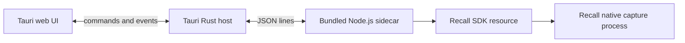
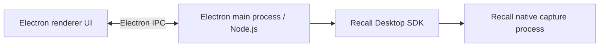
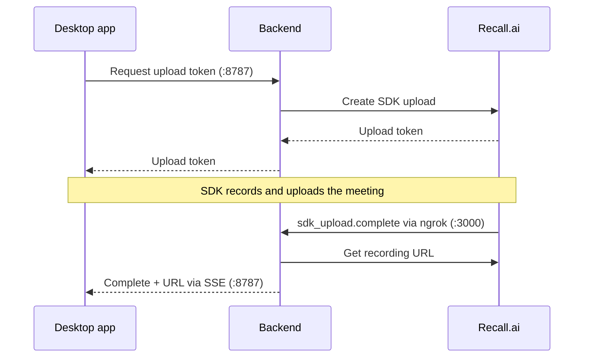

# Recall Desktop SDK + Tauri v2: Google Meet recorder

A small **macOS Apple Silicon** development sample. Join Google Meet in a visible Chrome tab, choose the detected meeting, and click **Start recording** or **Stop recording**. Recall's Desktop Recording SDK captures the meeting on the user's Mac without a meeting bot. The app shows the recording link after Recall sends `sdk_upload.complete`.

This is an SDK integration example, not a general screen recorder or an Electron/Tauri benchmark. The SDK performs capture; Tauri does not encode media or use a Rust capture crate here.

## Architecture diagrams

**Tauri: this repo.** The web UI talks to Rust. Tauri's shell plugin launches a bundled Node.js binary as a long-lived sidecar. The sidecar script and Recall SDK are bundled as resources. Commands and SDK events cross the Rust/Node boundary as JSON lines over standard input and output.

**Electron: equivalent integration.** Electron's main process already runs Node.js, so it can load the SDK directly. This is an architecture comparison; this repo only implements the Tauri app.

**Shared recording and completion flow.** Either app can use the same backend pattern. In this repo, the backend's local API listens on 8787, its webhook receiver listens on 3000, and ngrok forwards public HTTPS webhooks to the receiver. The UI gets completion through Server-Sent Events (SSE), with no status polling.

The first two diagrams show Recall SDK integration; they do not show Electron's `desktopCapturer` or Tauri's Rust screen capture crates. The two local ports are separate so a tunnel to the webhook port cannot expose the API endpoint that creates uploads. The backend keeps uploads in memory for this one-session demo. After a restart, the open app can reconnect with its upload ID, and a resent, verified webhook can restore its completion state. Recall's [non-Electron integration guide](https://docs.recall.ai/docs/integrating-with-non-electron-apps) describes the sidecar approach; the [Desktop SDK overview](https://docs.recall.ai/docs/desktop-sdk) describes the shared upload and webhook lifecycle.

## Requirements

- Apple Silicon Mac running macOS 13 or later, with Chrome and an active Google Meet call. The Meet tab must be visible or its picture-in-picture view shown for detection. Keep the meeting window on the current desktop for video capture.
- Node.js 22+, npm, Rust/Cargo, and [Tauri v2 macOS prerequisites](https://v2.tauri.app/start/prerequisites/).
- A Recall workspace, API key, and matching [regional API URL](https://docs.recall.ai/docs/desktop-sdk#starting-the-sdk).
- ngrok v3 with an authenticated account. `npm run tunnel` uses your account's assigned HTTPS dev domain by default. If you own a reserved domain, set `PUBLIC_API_BASE_URL` to its HTTPS origin (without `/api/webhook`) for the tunnel script. Use the hostname ngrok actually prints, not an example or placeholder.
- A webhook signing secret. For workspaces created on or after December 15, 2025, create a **workspace verification secret** in Recall's API keys page. Older accounts use the **Svix endpoint signing secret** shown on their webhook endpoint. Both begin with `whsec_`.

## Run

1. Run `npm ci`.
2. Copy `.sample.env` to `.env`, then set `RECALL_API_URL`, `RECALL_API_KEY`, and `RECALL_WEBHOOK_SECRET`. Use the same region for the URL, API key, and dashboard. Never commit `.env`.
3. In terminal 1 run `npm run backend`. It starts the local API on port 8787 and webhook receiver on port 3000. Confirm the terminal prints `Webhook receiver: http://127.0.0.1:3000/api/webhook`. Port 3000 must be free when the backend starts.
4. In terminal 2 run `npm run tunnel` (by default, `ngrok http 3000`). If an existing ngrok agent already forwards to port 3000, keep that agent running and skip this command. Check its `Forwarding` line: the HTTPS URL should point to `http://localhost:3000` (or `http://127.0.0.1:3000`). Copy the **actual** HTTPS URL, append `/api/webhook`, and enter that full URL in the [Recall webhooks dashboard](https://docs.recall.ai/docs/desktop-recording-sdk-webhooks). For example, `https://your-assigned-domain.ngrok-free.dev` becomes `https://your-assigned-domain.ngrok-free.dev/api/webhook`. Subscribe to `sdk_upload.complete`, `sdk_upload.failed`, `sdk_upload.recording_started`, and `sdk_upload.recording_ended`.
5. In terminal 3 run `npm run dev`. The app prepares the Tauri sidecar, then starts in development mode. On first run, preparation downloads an official Apple Silicon Node.js binary and stages the installed SDK files; later runs reuse them.
6. Join a Google Meet call in Chrome, grant Accessibility, Microphone, and Screen Recording permissions, select the detected meeting, and click **Start recording**. Click **Stop recording** and wait for the webhook. The app will show **Open completed recording** when Recall returns a video download URL.

On an unsigned development run, macOS may attribute permissions to your terminal or IDE. Grant access in **System Settings → Privacy & Security**, then restart the app if needed. Chrome may also need a restart after a permission change. Recording other people requires their consent under your organization's policy and applicable law.

### Bundled sidecar

Tauri's `bundle.externalBin` includes the official Node.js binary. Its `bundle.resources` includes `sidecar/index.cjs`, the installed `@recallai/desktop-sdk` directory (including its native executable and `Frameworks/`), and the SDK's runtime `uuid` dependency. `npm run prepare:sidecar` downloads Node.js v22.23.5 from nodejs.org, checks the archive against Node's published SHA-256 list, and stages these files. The generated files are ignored by Git. Tauri runs the bundled Node binary through its shell plugin, both in development and in a packaged build. This follows [Recall's Tauri guidance](https://docs.recall.ai/docs/integrating-with-non-electron-apps) and [Tauri's sidecar guide](https://v2.tauri.app/develop/sidecar/); Recall advises against bundling Homebrew's Node binary.

You can attempt a local macOS bundle with `npm run tauri build`. This sample's **backend is still a separate local process** and its API key stays there. Run `npm run backend` and an ngrok tunnel when using either the development app or a packaged app. The original demo only requires development mode; a signed, distributable build has not been verified.

If port 3000 is occupied, stop the other service or choose a different port. For example, run `WEBHOOK_PORT=8788 npm run backend` and `WEBHOOK_PORT=8788 npm run tunnel` in their respective terminals; then verify ngrok forwards to 8788. The dashboard URL still ends in `/api/webhook`. The receiver also accepts the older `/webhooks/recall` path, but this guide uses `/api/webhook` throughout.

## Project layout

| File | Role |
| --- | --- |
| [`src/main.ts`](src/main.ts) | Displays meeting details, recording status, and the completed video link. |
| [`src-tauri/src/lib.rs`](src-tauri/src/lib.rs) | Connects the UI to the long-running Node.js sidecar. |
| [`sidecar/index.cjs`](sidecar/index.cjs) | Runs the Recall Desktop SDK and starts and stops capture. |
| [`backend/server.mjs`](backend/server.mjs) | Creates uploads, verifies webhooks, and sends completion updates to the app. |
| [`scripts/prepare-sidecar.mjs`](scripts/prepare-sidecar.mjs) | Stages Node.js and SDK files for Tauri. |

## When the video is ready

After capture ends, the app shows **Processing** while Recall finishes the upload. The verified `sdk_upload.complete` webhook tells the backend to retrieve the video URL and send it to the app over Server-Sent Events; the app then shows **Complete**. The backend returns HTTP 503 if the video URL is not ready, allowing Recall to retry the webhook. An `sdk_upload.failed` event shows **Failed**.

## Troubleshooting

- **No meeting detected:** Confirm you're on an Apple Silicon Mac, the Meet tab is visible in Chrome, and the three permissions are granted. A Google Meet PWA and Companion Mode are not supported by the SDK.
- **Start fails:** Check your own local configuration, region, backend logs, and whether the local API is reachable at `http://127.0.0.1:8787/api/health`.
- **Processing never completes:** Confirm ngrok's `Forwarding` line ends in `http://localhost:3000` (or `http://127.0.0.1:3000`), and that this sample's backend is the process listening on that port. The dashboard webhook URL must be the public HTTPS URL plus `/api/webhook`, and the four events must be subscribed. A successful delivery in Recall's dashboard does not prove it reached this backend if another local service was listening on port 3000.
- **Find the webhook failure:** Open ngrok's local request inspector at `http://127.0.0.1:4040` while its agent is running. No `POST /api/webhook` means the public URL or Recall subscription needs checking. If ngrok shows a request but the backend prints nothing, check which process owns port 3000 and the tunnel's forwarding target. HTTP 401 means signature verification failed. HTTP 503 means the completion webhook arrived but the recording link was not ready from Recall. HTTP 204 means the receiver accepted the event; check the backend terminal for `sdk_upload.complete`.
- **ngrok reports `ERR_NGROK_108`:** Your account already has its allowed agent session running. Use that agent if it forwards to port 3000, or stop it before running `npm run tunnel`.
- **No video:** Keep Meet on the current desktop space. The SDK may capture audio but not video when the meeting window is on another space.
- **Recover the current recording after another service received the webhook:** Keep the Tauri app open and ngrok forwarding to port 3000. Stop the other service so port 3000 is free, then start `npm run backend` and confirm it prints `Webhook receiver: http://127.0.0.1:3000/api/webhook`. If Recall's dashboard offers a resend or replay action, resend this upload's `sdk_upload.complete` event. The app's SSE connection reconnects using its upload ID; the verified webhook restores the completed state without polling. A webhook previously delivered to the old service will not automatically reach the new one. If the desktop app was closed too, its current upload ID is lost; find the recording in Recall instead.

## References

- [Recall Desktop Recording SDK](https://docs.recall.ai/docs/desktop-sdk)
- [Integrating with non-Electron apps](https://docs.recall.ai/docs/integrating-with-non-electron-apps)
- [Desktop SDK event types](https://docs.recall.ai/docs/desktop-recording-sdk-event-types)
- [Desktop SDK webhooks](https://docs.recall.ai/docs/desktop-recording-sdk-webhooks)
- [Verifying Recall webhooks](https://docs.recall.ai/docs/authenticating-requests-from-recallai)
- [Desktop SDK supported platforms](https://docs.recall.ai/docs/dsdk-supported-platforms)
